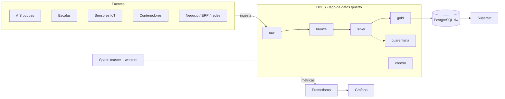

# Arquitectura de la plataforma (plantilla · fase 1)

> Completad y mantened este documento durante todo el proyecto. GitHub dibuja los diagramas `mermaid`.

## 1. Vista general

## 2. Zonas del lago de datos
| Zona | Contenido | Formato | Particionado | Quién escribe | Retención |
|---|---|---|---|---|---|
| raw |Datos tal cual llegan de cada fuente (AIS, escalas, sensores, contenedores, negocio, maestros), sin tocar | Originales (CSV/JSON)| Una carpeta por fuente| ingesta.sh (put -f)| Permanente: es el origen para reprocesar|
| bronze | Los mismos datos con tipos correctos y linaje (_fichero_origen, _ingestado)| Parquet| Por fecha (AIS, sensores) y por año (escalas)| Spark (notebook F1)| Larga|
| silver | Datos limpios, validados y sin duplicados| Parquet| Por fecha| Spark (fase 3)|Media (se regenera desde bronze) |
| gold | Resúmenes y tablas de negocio listas para informes| Parquet| Sin particionar (tablas pequeñas)| Spark SQL| Se regenera cuando haga falta|
| cuarentena | Filas con errores o corruptas, apartadas para revisarlas| Parquet| Por fecha de carga| Spark (fase 3)|Hasta revisarlas y corregir el origen |
| control | Registro de qué se ha cargado y cuándo (ingestas.jsonl) y manifiesto | JSONL / sha256 | Sin particionar | ingesta.sh | Permanente (auditoría) |

## 3. Fuentes e ingesta

| Fuente | Tipo | Frecuencia real | Volumen/día | Mecanismo propuesto | Idempotente |
|---|---|---|---|---|---|

## 4. Decisiones de diseño (registro)
| Fecha | Decisión | Alternativas | Motivo |
|---|---|---|---|

## 5. Componentes y recursos

| Servicio | Función | Réplicas | Memoria |
|---|---|---|---|
| HDFS NameNode | Metadatos del sistema de ficheros: árbol de zonas (raw, bronze, silver, gold, cuarentena, control) y localización de bloques | 1 | 1 GB |
| HDFS DataNode | Almacenamiento de bloques de datos (factor de replicación 2) | 2 | 1 GB c/u |
| YARN ResourceManager | Planificación y reparto de recursos entre los jobs de Spark | 1 | 1 GB |
| YARN NodeManager | Ejecuta los contenedores de Spark (driver y executors) | 2 | 3 GB c/u |
| Spark (driver + executors) | Procesado bronze → silver → gold (notebook F1, fase 3 y Spark SQL). Se lanza bajo demanda sobre YARN | Dinámico (1 driver + 2 executors) | Driver 1 GB, executor 2 GB c/u (dentro de los NodeManager) |
| Spark History Server | Histórico de ejecuciones, para auditar y depurar jobs | 1 | 1 GB |
| Hive Metastore | Catálogo de tablas (gold, silver) para Spark SQL e informes | 1 | 1 GB |
| PostgreSQL | Base de datos del Metastore | 1 | 512 MB |
| JupyterLab | Entorno de notebooks (PySpark) para desarrollo y exploración | 1 | 2 GB |
| Cliente de ingesta | Contenedor que ejecuta `ingesta.sh` (`hdfs dfs -put -f`) hacia raw y control | 1 | 256 MB |

