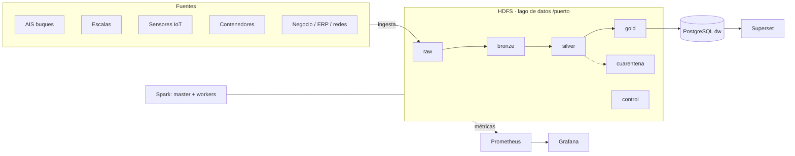

# Arquitectura de la plataforma (plantilla · fase 1)

> Completad y mantened este documento durante todo el proyecto. GitHub dibuja los diagramas `mermaid`.

## 1. Vista general

## 2. Zonas del lago de datos
| Zona | Contenido | Formato | Particionado | Quién escribe | Retención |
|---|---|---|---|---|---|
| raw |Datos tal cual llegan de cada fuente (AIS, escalas, sensores, contenedores, negocio, maestros), sin tocar | Originales (CSV/JSON)| Una carpeta por fuente| ingesta.sh (put -f)| Permanente: es el origen para reprocesar|
| bronze | Los mismos datos con tipos correctos y linaje (_fichero_origen, _ingestado)| Parquet| Por fecha (AIS, sensores) y por año (escalas)| Spark (notebook F1)| Larga|
| silver | Datos limpios, validados y sin duplicados| Parquet| Por fecha| Spark (fase 3)|Media (se regenera desde bronze) |
| gold | Resúmenes y tablas de negocio listas para informes| Parquet| Sin particionar (tablas pequeñas)| Spark SQL| Se regenera cuando haga falta|
| cuarentena | Filas con errores o corruptas, apartadas para revisarlas| Parquet| Por fecha de carga| Spark (fase 3)|Hasta revisarlas y corregir el origen |
| control | Registro de qué se ha cargado y cuándo (ingestas.jsonl) y manifiesto| JSONL / sha256| Sin particionar| ingesta.sh	 |Permanente (auditoría)

## 3. Fuentes e ingesta

| Fuente | Tipo | Frecuencia real | Volumen/día | Mecanismo propuesto | Idempotente |
|---|---|---|---|---|---|
| AIS | Datos de posicionamiento de buques | Cada 5 minutos | Medio/alto (estimado) | `ingesta.sh` (CSV/JSON a `raw`) | Sí, por fichero |
| Escalas | Datos de escalas de buques | Diaria, con actualizaciones cuando cambian las escalas | Bajo (estimado) | `ingesta.sh` (CSV/JSON a `raw`) | Sí, por fichero |
| Sensores | Mediciones ambientales y operativas | Cada minuto | Medio/alto (estimado) | `ingesta.sh` (CSV/JSON a `raw`) | Sí, por fichero |
| Contenedores | Registros de contenedores y movimientos | Cada hora | Medio (estimado) | `ingesta.sh` (CSV/JSON a `raw`) | Sí, por fichero |
| Negocio | Datos de actividad y operaciones | Una vez al día, al cierre de la jornada | Bajo/medio (estimado) | `ingesta.sh` (CSV/JSON a `raw`) | Sí, por fichero |
| Maestros | Tablas de referencia: buques, puertos y códigos | Una vez al día y cuando haya cambios relevantes | Bajo (estimado) | `ingesta.sh` (CSV/JSON a `raw`) | Sí, por fichero |
## 4. Decisiones de diseño (registro)
| Fecha | Decisión | Alternativas | Motivo |
|---|---|---|---|

## 5. Componentes y recursos
| Servicio | Función | Réplicas | Memoria |
|---|---|---|---|
