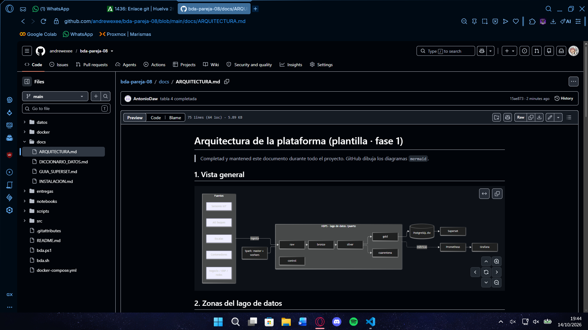
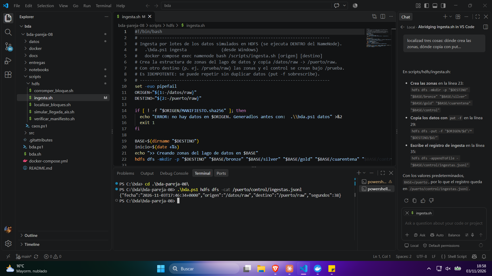
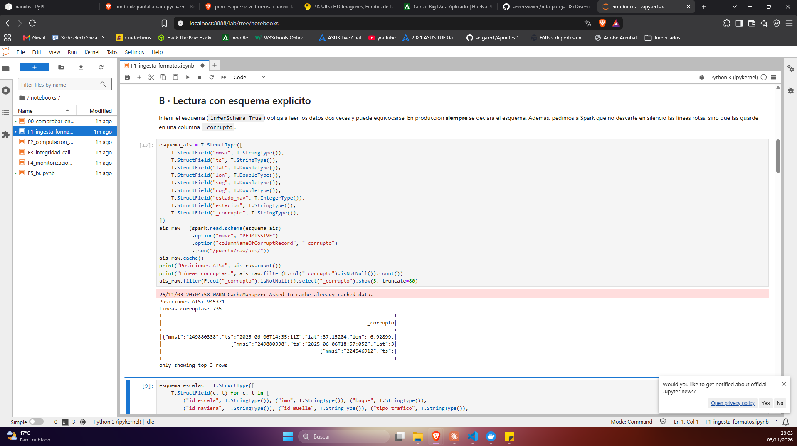
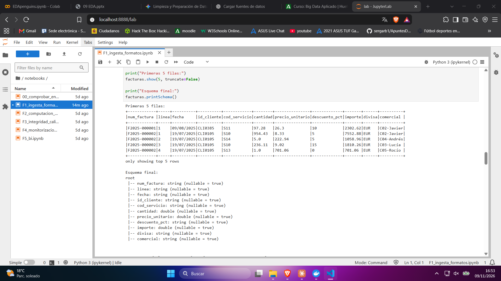
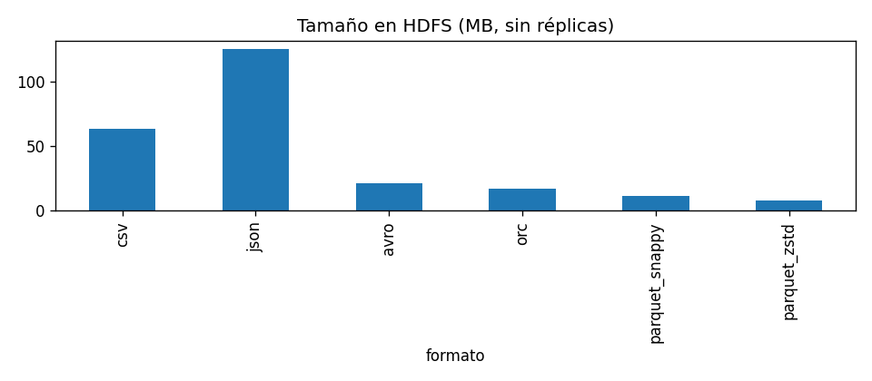
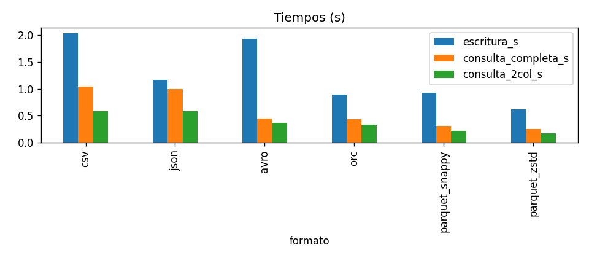
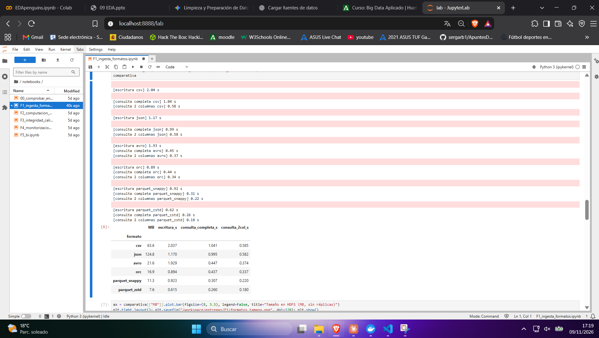
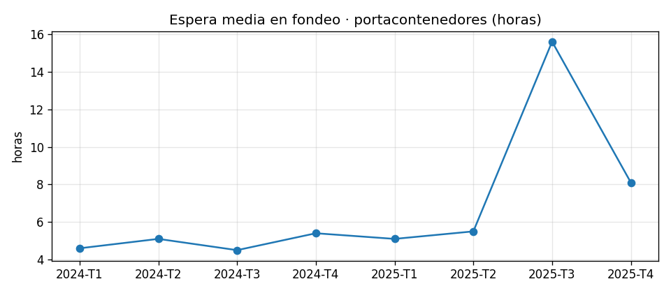

# Memoria de la fase 1 · Diseño del centro de datos e ingesta (RA1)

> Rellenad esta plantilla en Markdown dentro del repositorio. Las imágenes van en esta misma carpeta
> (``). La entrega es el **tag de Git** `F1-entrega` + el ZIP en Moodle.

## 0. Datos de la pareja

| | Miembro 1 | Miembro 2 |Miembro 3 |
|---|---|---|---|
| Nombre |Andrés |Álvaro |Antonio |
| Usuario de GitHub | andrewexee|AlvaroRamirez10 |AntonioDaw |
| Partes de las que es responsable principal | | |

**Horas dedicadas aproximadas:** ___  ·  **Commit final:** `______`

## 1. Resumen (máx. 10 líneas)


## 2. Desarrollo por criterio de evaluación

> Cada apartado se corrige con la fila correspondiente de la rúbrica. Sin evidencias, el apartado no se puntúa.
>
> **Normas de las evidencias (obligatorias):**
> - Cada apartado lleva **capturas de pantalla propias** (pantalla completa o ventana completa, no recortes sueltos)
>   en las que se vea el **reloj de Windows** y, cuando sea un cuaderno, la salida del **sello de evidencia**
>   (`sello(PAREJA)`, primera celda) o de un comando ejecutado en ese momento.
> - Guardad las capturas en esta carpeta con nombre descriptivo (`F2_D1_datanode_muerto.png`) e insertadlas
>   con ``. Debajo de cada una, una línea explicando qué demuestra.
> - Además de las capturas: los comandos exactos, las salidas relevantes (copiadas como texto) y las tablas y gráficos generados.
> - Las evidencias deben coincidir con el historial de commits y con el cuaderno entregado.

### CE1.a · Diseño de la solución de almacenamiento

*Qué se espera:* Diagrama de arquitectura (zonas raw/bronze/silver/gold/cuarentena/control, servicios, flujos) y justificación de cada decisión. Enlazad `docs/ARQUITECTURA.md`.

La arquitectura completa está en [docs/ARQUITECTURA.md](../../docs/ARQUITECTURA.md). Guardamos los datos en HDFS y los organizamos en zonas. `raw` conserva los ficheros originales para poder volver a procesarlos; `bronze` contiene los datos con tipos y metadatos; `silver` guarda los datos limpios; y `gold` contiene resultados preparados para los informes. Los registros de control y los datos que necesitan revisión se guardan por separado.

Elegimos Parquet para las zonas procesadas porque está pensado para consultas analíticas y permite leer solo las columnas necesarias. Particionar por fecha o año ayuda a limitar los datos que Spark tiene que leer. Spark procesa los datos y YARN gestiona los recursos. JupyterLab sirve para ejecutar los notebooks; Hive Metastore y PostgreSQL guardan el catálogo; Superset muestra los resultados y Prometheus con Grafana ayuda a vigilar el sistema.



### CE1.b · Ingesta de datos

*Qué se espera:* Tabla de fuentes (frecuencia, volumen/día, mecanismo). Evidencia de la ingesta por lotes (salida de `ingesta.sh`, `/puerto/control/ingestas.jsonl`). Propuesta de ingesta incremental. Lectura con esquema y tratamiento de registros corruptos (TAREA B1).

La tabla de fuentes, con su frecuencia, volumen diario y mecanismo de ingesta, está en [docs/ARQUITECTURA.md](../../docs/ARQUITECTURA.md).

La ingesta por lotes se ejecuta con `bda.ps1 ingesta`. El script crea las carpetas de las zonas del lago, copia los ficheros de `/datos/raw` a `/puerto/raw` y guarda el manifiesto en `/puerto/control`. Para copiar usa `hdfs dfs -put -f`: si un fichero con el mismo nombre ya existe en el destino, lo sobrescribe. Así se pueden repetir los datos sin duplicar esos ficheros. Al final, añade una línea al historial `/puerto/control/ingestas.jsonl`.

Consultamos el historial con este comando:

```powershell
.\bda.ps1 hdfs dfs -cat /puerto/control/ingestas.jsonl
```

La salida registrada indica que la carga se hizo desde `/datos/raw` hacia `/puerto/raw` y tardó 38 segundos.



Para simular una llegada incremental de AIS, `simular_llegada_ais.sh` copia los ficheros diarios, uno cada cierto tiempo, a `/puerto/landing/ais`. En un sistema real, una herramienta como Kafka o MQTT podría recibir las posiciones y Spark Structured Streaming procesarlas según llegan. Los puntos de control del proceso ayudarían a reanudarlo sin volver a leer todo desde el principio.

En la lectura de AIS declaramos el esquema y configuramos Spark en modo `PERMISSIVE` para guardar las líneas mal formadas en `_corrupto`. La ejecución contó 945371 posiciones AIS y encontró 735 líneas corruptas, que quedan disponibles para revisarlas.



En la TAREA B1 leímos `facturas_2025.csv` con `;` como separador y declaramos inicialmente las columnas como texto. Después cambiamos la coma decimal por un punto y convertimos `cantidad`, `precio_unitario` e `importe` a `double`. La salida de la celda muestra las cinco primeras filas y el esquema final.



### CE1.c · Formato de almacenamiento

*Qué se espera:* Tabla y gráficos de la comparativa de formatos con VUESTROS números; formato elegido por zona y por qué; particionado y problema de ficheros pequeños.

Comparamos seis formatos usando las posiciones AIS. Medimos el tamaño lógico guardado en HDFS y el tiempo de escritura y de dos consultas. Estos son los resultados de la primera ejecución:

| Formato | Tamaño (MB) | Escritura (s) | Consulta completa (s) | Consulta de 2 columnas (s) |
|---|---:|---:|---:|---:|
| CSV | 63,6 | 2,084 | 1,727 | 0,997 |
| JSON | 124,8 | 1,871 | 1,250 | 0,905 |
| Avro | 21,6 | 1,124 | 1,222 | 0,546 |
| ORC | 16,9 | 1,733 | 1,326 | 0,513 |
| Parquet Snappy | 11,3 | 1,728 | 0,685 | 0,407 |
| Parquet ZSTD | 7,6 | 0,896 | 0,355 | 0,309 |





En la primera ejecución, JSON ocupó más espacio (124,8 MB) y Parquet ZSTD menos (7,6 MB). Para la consulta de dos columnas, Parquet ZSTD tardó 0,309 segundos, frente a 0,997 segundos en CSV. En esta prueba, Parquet ZSTD también tuvo el menor tiempo de escritura y de consulta completa. Son resultados de este conjunto de datos y de una ejecución; no garantizan los mismos tiempos en otros equipos.

Al repetir la medición, los tamaños se mantuvieron, pero los tiempos cambiaron. Las dos consultas fueron más rápidas en la segunda ejecución para los seis formatos; por ejemplo, la consulta completa de CSV pasó de 1,727 a 1,041 s y la consulta de dos columnas con Parquet ZSTD, de 0,309 a 0,180 s. Los tiempos de escritura no siguieron el mismo patrón: casi todos bajaron, pero Avro subió de 1,124 a 1,929 s. La caché, el calentamiento de Spark y la carga del equipo pueden influir en estas diferencias.



Para C2 proponemos Parquet ZSTD en bronze, silver y gold: en esta medición fue el formato más compacto y tuvo las consultas más rápidas. Parquet es columnar, por lo que Spark puede leer solo las columnas solicitadas (*column pruning*). Snappy suele priorizar menor coste de CPU; ZSTD suele comprimir más, aunque puede exigir más CPU. En nuestra medición ZSTD obtuvo mejores tiempos, pero no medimos el uso de CPU.

CSV, JSON y Avro almacenan los registros por filas; Parquet y ORC los almacenan por columnas. Avro, Parquet y ORC incluyen información de esquema en sus archivos; CSV y JSON no guardan un esquema formal. Los ficheros de texto sin comprimir se pueden dividir por líneas para procesarlos en paralelo; un fichero comprimido con gzip normalmente no se puede dividir de la misma manera. Avro, Parquet y ORC también admiten lectura paralela por bloques o grupos, según el formato y cómo se hayan escrito.

Particionar por fecha o año permite leer solo los periodos que necesita una consulta. Hay que evitar crear demasiados ficheros pequeños: cada fichero añade metadatos y trabajo de planificación, aunque contenga pocos datos. Reparticionar por la columna de partición antes de escribir ayuda a controlar cómo se distribuyen los datos.


### CE1.d · Procesamiento

**TAREA D1 · Creación de la zona BRONZE**

Se ha realizado la ingesta de las fuentes de datos pendientes en la zona BRONZE de HDFS, convirtiéndolas al formato Parquet y definiendo sus esquemas para establecer los tipos de datos adecuados.

Se han procesado las siguientes fuentes:

| Fuente | Registros |
|---|---:|
| Sensores | 1.348.728 |
| Contenedores | 400.182 |
| Muelles | 12 |
| Navieras | 40 |
| Buques | 320 |

Para garantizar la trazabilidad de los datos, se han añadido dos columnas de linaje:

- `_fichero_origen`: identifica el fichero de procedencia de cada registro.
- `_ingestado`: registra la fecha y hora de ingesta.

En el caso de los sensores, se ha creado la columna `fecha` a partir de `ts`, particionando los datos por fecha para facilitar las consultas posteriores. También se ha tenido en cuenta que las marcas temporales originales incluyen el desplazamiento horario `+02:00`.

Los contenedores se han convertido a Parquet manteniendo sus campos y tipos de datos, transformando la columna `ts` a timestamp.

Por último, se han procesado los tres ficheros maestros (`muelles`, `navieras` y `buques`), conservando los identificadores como texto cuando es necesario para evitar pérdidas de información.

**Comprobación de resultados**

Se ha verificado la correcta generación de los Parquet mediante su lectura con Spark, el recuento de registros y la consulta de los directorios de HDFS.

Las fuentes se encuentran almacenadas en:

- `/puerto/bronze/sensores`
- `/puerto/bronze/contenedores`
- `/puerto/bronze/maestros/muelles`
- `/puerto/bronze/maestros/navieras`
- `/puerto/bronze/maestros/buques`

La comprobación confirma que las cinco fuentes procesadas se han almacenado correctamente en la zona BRONZE.

**TAREA E1 · Consultas Spark SQL y generación de la zona GOLD**

Se han registrado las vistas temporales necesarias para consultar las fuentes de la zona BRONZE y se han ejecutado tres consultas mediante Spark SQL. Los resultados se han almacenado en formato Parquet dentro de `/puerto/gold`.

#### 1. Las 10 navieras con más toneladas en 2025

**Consulta SQL:**

```sql
SELECT n.id_naviera, n.nombre AS naviera, n.pais,
       t.escalas, t.miles_t
FROM (
    SELECT id_naviera,
           COUNT(*) AS escalas,
           ROUND(SUM(toneladas) / 1000, 1) AS miles_t
    FROM escalas
    WHERE year(eta) = 2025
      AND toneladas BETWEEN 0 AND 500000
    GROUP BY id_naviera
    ORDER BY SUM(toneladas) DESC
    LIMIT 10
) t
JOIN navieras n ON n.id_naviera = t.id_naviera
ORDER BY t.miles_t DESC
```

**Resultado (primeras filas):**

| Naviera | País | Escalas | Miles de toneladas |
|---|---|---:|---:|
| Azores Naviera | Italia | 131 | 3.597,8 |
| Atlántica Naviera | Noruega | 125 | 3.560,3 |
| Tinto Maritime | Noruega | 97 | 2.898,4 |
| Iberia Maritime | España | 124 | 2.839,0 |
| Mare Nostrum Maritime | Italia | 90 | 2.783,7 |

**Qué responde:** identifica las diez navieras con mayor volumen de mercancías transportadas durante 2025, mostrando sus toneladas acumuladas y el número de escalas realizadas.

**Almacenamiento:** `/puerto/gold/f1_top_navieras_2025`

#### 2. Ocupación de cada muelle por mes

**Consulta SQL:**

```sql
SELECT e.id_muelle,
       m.nombre AS muelle,
       date_format(e.ata, 'yyyy-MM') AS mes,
       COUNT(*) AS escalas,
       ROUND(SUM(
           (unix_timestamp(e.atd) - unix_timestamp(e.ata)) / 3600
       ), 1) AS horas_atracadas,
       ROUND(SUM(
           (unix_timestamp(e.atd) - unix_timestamp(e.ata)) / 3600
       ) / (24 * dayofmonth(last_day(e.ata))) * 100, 1) AS ocupacion_pct
FROM escalas e
JOIN muelles m ON m.id_muelle = e.id_muelle
WHERE e.ata IS NOT NULL
  AND e.atd IS NOT NULL
  AND e.atd >= e.ata
GROUP BY e.id_muelle, m.nombre,
         date_format(e.ata, 'yyyy-MM'),
         dayofmonth(last_day(e.ata))
ORDER BY e.id_muelle, mes
```

**Resultado (primeras filas):**

| Muelle | Mes | Escalas | Horas atracadas | Ocupación (%) |
|---|---|---:|---:|---:|
| Muelle Sur | 2024-01 | 33 | 709,3 | 95,3 |
| Muelle Sur | 2024-02 | 33 | 726,5 | 104,4 |
| Muelle Sur | 2024-03 | 43 | 866,3 | 116,4 |
| Muelle Sur | 2024-04 | 39 | 821,5 | 114,1 |
| Muelle Sur | 2024-05 | 37 | 822,8 | 110,6 |

**Qué responde:** permite analizar la actividad y ocupación mensual de cada muelle, identificando los periodos de mayor utilización. Los porcentajes superiores al 100 % reflejan que la suma de horas de atraque supera las horas naturales disponibles del mes, debido a posibles solapamientos entre escalas.

**Almacenamiento:** `/puerto/gold/f1_ocupacion_muelles_mes`

#### 3. Pregunta propia: ¿Cuántas horas al día se superarían los 14 m/s de viento?

Se analiza la velocidad del viento registrada por el sensor METEO-01. Se considera que, por encima de 14 m/s, las grúas tendrían que detener su actividad.

**Consulta SQL:**

```sql
SELECT fecha,
       COUNT(DISTINCT ts) AS minutos_medidos,
       COUNT(DISTINCT CASE
           WHEN valor > 14 THEN ts
       END) AS minutos_viento_fuerte,
       ROUND(
           COUNT(DISTINCT CASE
               WHEN valor > 14 THEN ts
           END) / 60.0, 1
       ) AS horas_gruas_paradas,
       ROUND(MAX(valor), 1) AS racha_max_ms
FROM sensores
WHERE id_sensor = 'METEO-01'
  AND variable = 'viento_vel'
  AND valor IS NOT NULL
  AND valor BETWEEN 0 AND 60
GROUP BY fecha
ORDER BY horas_gruas_paradas DESC, fecha
```

**Resultado (primeras filas):**

| Fecha | Minutos medidos | Minutos viento fuerte | Horas equivalentes | Máximo (m/s) |
|---|---:|---:|---:|---:|
| 2025-07-10 | 1.439 | 417 | 7,0 | 17,3 |
| 2025-06-23 | 1.440 | 355 | 5,9 | 16,9 |
| 2025-06-06 | 1.439 | 87 | 1,5 | 15,3 |
| 2025-07-27 | 1.440 | 49 | 0,8 | 15,8 |
| 2025-06-01 | 1.439 | 0 | 0,0 | 8,5 |

**Qué responde:** identifica los días en los que las condiciones de viento podrían limitar la actividad de las grúas, cuantificando el tiempo diario por encima del umbral de 14 m/s.

**Almacenamiento:** `/puerto/gold/f1_viento_fuerte_diario`

#### Comprobación de almacenamiento

Se ha comprobado mediante el listado de HDFS que los resultados de las tres consultas se han almacenado correctamente en la zona GOLD, en formato Parquet.

- `/puerto/gold/f1_top_navieras_2025`
- `/puerto/gold/f1_ocupacion_muelles_mes`
- `/puerto/gold/f1_viento_fuerte_diario`

Las consultas permiten obtener información sobre el tráfico marítimo, la ocupación de los muelles y las posibles limitaciones operativas provocadas por las condiciones meteorológicas.

### CE1.e · Presentación al cliente

*Qué se espera:* Informe ejecutivo de 1 página: ≤ 3 gráficos, 3 conclusiones en lenguaje no técnico y 1 recomendación.


#### Evolución de la espera

Durante 2024, los portacontenedores mantuvieron una espera media relativamente estable, entre 4,5 y 5,4 horas por trimestre. La primera mitad de 2025 siguió una tendencia similar, pero en el tercer trimestre se produjo un fuerte aumento, hasta alcanzar las 15,6 horas de media. En el último trimestre la situación mejoró, aunque la espera todavía se situó por encima de los valores habituales.



#### Tres conclusiones principales

1. **La espera aumentó considerablemente en 2025.** La media anual aproximada pasó de 4,9 horas en 2024 a 8,6 horas en 2025, un incremento cercano al 75 %.

2. **El principal problema se concentró en el tercer trimestre.** La espera alcanzó las 15,6 horas, casi el triple que en el trimestre anterior. El número de escalas fue de 111, frente a las 87 del mismo trimestre de 2024.

3. **La situación mejoró al final del año, pero no volvió a la normalidad.** En el cuarto trimestre la espera bajó a 8,1 horas, aunque siguió siendo un 50 % superior a la del cuarto trimestre de 2024.

#### Recomendación

Analizar con mayor detalle las operaciones del tercer trimestre de 2025 para identificar las causas del incremento de las esperas. Se recomienda revisar la planificación de atraques y la disponibilidad de muelles, y establecer un seguimiento periódico de los tiempos de espera para anticipar posibles congestiones y mejorar la coordinación de las llegadas de los buques.


## 3. Problemas encontrados y cómo los resolvimos


Durante el desarrollo de la práctica encontramos dificultades relacionadas con la lectura, transformación, almacenamiento y rendimiento de los datos.

| Problema / mensaje de error | Causa | Solución | Fuente consultada |
|---|---|---|---|
| 735 líneas AIS corruptas detectadas durante la lectura. | Algunos registros JSON estaban mal formados o incompletos. | Declaramos un esquema y configuramos Spark en modo `PERMISSIVE`, almacenando las líneas problemáticas en la columna `_corrupto` para poder identificarlas y revisarlas. | Documentación de Spark y registros AIS proporcionados. |
| Diferentes formatos de fecha en los registros de escalas. | Los datos de origen no utilizaban un único formato de fecha y hora. | Se preparó una conversión que permite interpretar los formatos encontrados antes de realizar las operaciones con fechas. | Ficheros de escalas y funciones de PySpark. |
| Facturas con separador y decimales diferentes del formato esperado. | El fichero utiliza `;` como separador y la coma como separador decimal. | Se indicó el separador correcto, se leyeron inicialmente las columnas como texto y se sustituyó la coma decimal por un punto antes de convertir los campos numéricos a `double`. | `facturas_2025.csv` y documentación de PySpark. |
| Diferencias en los tiempos de las dos ejecuciones de la comparativa de formatos. | Los tiempos de ejecución pueden verse afectados por la caché, el calentamiento de Spark y la carga del equipo. | Se repitieron las mediciones y se conservaron los resultados de ambas ejecuciones para comparar los cambios, sin considerar los tiempos como valores absolutos. | Resultados de las dos ejecuciones del notebook. |
| Riesgo de generar demasiados ficheros pequeños al particionar. | La escritura distribuida puede producir varios ficheros por partición, aumentando los metadatos y el trabajo de planificación. | Se explicó la necesidad de controlar la distribución de los datos antes de escribir y se utilizó el particionado por fecha o año según la fuente. | Documentación de Spark y pruebas de particionado. |
| Diferencia entre tamaño lógico y espacio ocupado en HDFS. | HDFS puede mantener varias réplicas de los bloques almacenados. | Se tuvo en cuenta la replicación al interpretar el espacio ocupado y comparar los formatos. | Comandos de consulta de HDFS y configuración del entorno. |


## 4. Conclusiones y mejoras propuestas


## 5. Declaración de uso de herramientas

Indicad qué herramientas de IA o fuentes externas habéis usado, **para qué** y qué parte es vuestra.
Recordad: el profesor puede pedir a cualquier miembro que defienda oralmente cualquier parte. Lo que no se sepa explicar se considera no realizado (cláusula de autoría de la programación).

| Herramienta / fuente | Para qué | Partes afectadas |
|---|---|---|
| | | |
